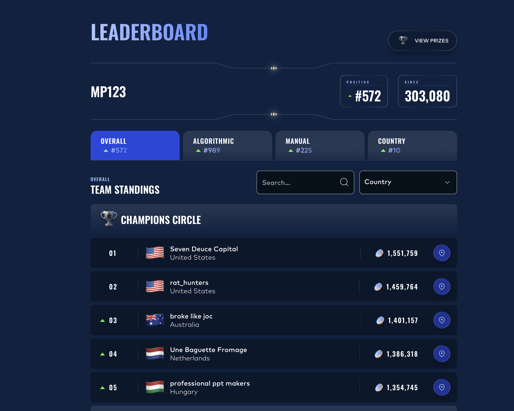

# IMC Prosperity 4 — Algorithmic Trading Competition & Research Reconstruction

<div align="center">

**Team MP123 · #572 / 18,803 overall (Top 3.1%) · #10 in China**  
**#225 manual · #989 algorithmic · 303,080 XIRECs**

</div>

<p align="center">
  <br>
  <sub>Official competition results for Team MP123.</sub>
</p>

## Competition Performance

IMC Prosperity 4 combined five rounds of algorithmic trading with a separately scored manual track. Team MP123 finished **#572 among 18,803 teams (Top 3.1%)**, including **#225 in manual trading**, **#989 in algorithmic trading**, and **#10 in China**.

These are the original competition results. No revised or simulated strategy in this repository is presented as a live competition rank.

## What This Repository Is

This repository combines three distinct layers:

1. **Competition-time record** — the original submitted Python strategies, exchange logs, fills, scores, and leaderboard evidence.
2. **Post-competition research** — statistical diagnosis of each market, reconstruction of algorithm decisions, and analysis of fair value, execution, and risk.
3. **Counterfactual research** — revised rules or simulations used to test specific hypotheses. These are explicitly labelled and are not treated as live results.

The objective is not to rewrite the competition after the fact. It is to show how trading hypotheses can be made measurable, replayed against the original evidence, and revised without obscuring what was actually submitted.

## Research / Trading Framework

Every round is examined through the same sequence:

> **market structure → statistical diagnosis → fair value → tradability and execution cost → trading rule → validation and replay**

The toolkit includes variance ratios, autocorrelation decay, residual analysis, trend-versus-mean-reversion diagnosis, structural pricing identities, Black–Scholes and option fair value, depth imbalance, aggressor flow, spread economics, cross-asset and basket relationships, counterparty-signal analysis, and inventory/position constraints.

The central discipline is to separate a statistically interesting relationship from an executable trade. A fair-value identity can be valuable even when the spread makes the apparent arbitrage untradeable; a low variance ratio can reflect microstructure noise rather than persistent mean reversion; and realized PnL alone does not validate the logic that produced it.

## Key Findings Across Five Rounds

- **A low variance ratio is not sufficient evidence of tradeable mean reversion.** Autocorrelation decay separates persistent reversion from residual noise that disappears within a tick.
- **Structural identities can improve fair value without creating executable arbitrage.** Deep-in-the-money option parity in Round 3 and the five-product PEBBLES identity in Round 5 were both tighter than fitted alternatives, but their deviations sat inside multi-leg execution costs.
- **Pooling across days can manufacture counterparty significance.** Round 4's apparent signal did not survive day-by-day stability checks, so preserving the existing model was more defensible than fitting to three days of participant labels.
- **Realized PnL is not the same as evidence that a strategy was correct.** Directional inventory can profit from the scored day's drift even when its measured predictive relationship is negligible.
- **Individual assets can resemble random walks while cross-asset structure remains.** Round 5's fitted pairs did not revert, yet one five-product group maintained a stable sum across all observed days.

## Representative Research Case — Round 3 Options Market

**Market.** Round 3 introduced two spot products and ten call vouchers across strikes, with position limits and a live order book.

**Competition-time implementation.** The submitted source used moving-average mean reversion for the two spot products and Black–Scholes values from a fitted volatility smile for six voucher strikes. A volatility gate prevented the voucher module from emitting orders; the original code is preserved in [`submissions/round3.py`](submissions/round3.py).

**Retrospective diagnosis.** The spot series were consistent with random walks rather than the persistent reversion seen earlier. Across the option chain, the deep-in-the-money vouchers satisfied `C ≈ S − K` to within 0.01, providing an observable fair-value identity that required no volatility estimate.

**Tradability.** The deep-ITM basis had standard deviation 0.82, but the relevant spread was 21 ticks. The identity was therefore useful for pricing and quoting, not as executable arbitrage. Flow analysis also showed that the option business was strongly one-sided, making underlying delta hedging and inventory control essential.

**Validation.** Replaying the original submitted source explained **740 / 740 exchange fills**, and reconstructed orders were identical to the logged orders at **9,986 / 10,000 timestamps**. Counterfactual threshold tests showed that simply opening the inactive voucher gate would have worsened simulated performance; this separates the visible operational symptom from the deeper strategy-design issue.

**Conclusion.** Round 3 demonstrates the full research chain: identify the price process, distinguish model-based value from structural value, compare signal magnitude with execution cost, account for one-sided flow and inventory, and test the original implementation against exchange evidence.

[Round 3 analysis](rounds/03/) · [research notebook](research/round3.ipynb) · [strategy specification](rounds/03/answer.md) · [interactive replay](rounds/03/replay/vev-4000.html)

## Decision Reconstruction / Replay Engine

The replay system is the repository's audit layer. It:

- rebuilds each `TradingState` from the exchange log;
- executes the **original submitted source**, rather than a paraphrased reimplementation;
- traces internal variables, comparisons, and branches;
- reconstructs the orders emitted at each timestamp; and
- matches those orders against actual exchange fills by timestamp, side, and compatible price.

| Round | Exchange fills explained | Additional validation |
|---|---:|---|
| 1 | **763 / 763 (100%)** | interactive decision traces |
| 2 | **632 / 632 (100%)** | interactive decision traces |
| 3 | **740 / 740 (100%)** | orders identical on **9,986 / 10,000** timestamps |
| 4 | **1,270 / 1,272 (99.84%)** | remaining mismatch retained as a limitation |

This makes the retrospective falsifiable: an explanation is useful only if the original code, reconstructed state, emitted orders, and observed fills agree.

[R1 ASH replay](rounds/01/replay/ash.html) · [R2 ROOT replay](rounds/02/replay/root.html) · [R3 VEV 4000 replay](rounds/03/replay/vev-4000.html) · [R4 HYDROGEL replay](rounds/04/replay/pack.html)

## Manual Trading

The manual track finished **#225 overall** and contributed 225,345 XIRECs across the three rounds scored individually, versus 77,736 from those rounds' algorithmic submissions. It tested sealed-bid sizing, game-theoretic resource allocation, strategic bidding, option-portfolio construction, and news-driven allocation under nonlinear fees.

The strongest single-round result was **Round 4 manual: 72,278 XIRECs and rank #178**. The manual review preserves the submitted answers and scores, distinguishes surviving evidence from missing working, and analyzes payoff geometry and sizing without replacing the historical record.

[Read the manual track](manual/)

## Five-Round Map

| Round | Market theme | What was tested | Best validated takeaway | Materials |
|---|---|---|---|---|
| 1 | Trend and mean reversion | price-process identification; depth imbalance | autocorrelation persistence is needed to distinguish reversion from one-tick residual noise | [Round 1](rounds/01/) |
| 2 | Regime stability | structural parameters versus estimates | revalidate estimated signals across days; do not confuse scored-day PnL with predictive evidence | [Round 2](rounds/02/) |
| 3 | Spot and options | fair value, flow, hedging, execution | structural option value can dominate fitted value, yet remain non-arbitrageable after spread | [Round 3](rounds/03/) |
| 4 | Counterparty identities | incremental information and stability | per-day validation rejected a pooled counterparty effect as insufficiently robust | [Round 4](rounds/04/) |
| 5 | Fifty cross-asset products | relationship selection under breadth | one stable basket identity survived; fitted pairs did not show spread reversion | [Round 5](rounds/05/) |

## Repository Structure

```text
rounds/01..05/     round summaries, evidence-backed specifications, and interactive replays
research/          notebooks for statistical diagnosis and derivation
submissions/       original competition-time algorithms, preserved unmodified
tools/             replay, tracing, validation, and benchmarking utilities
manual/            manual-trading submissions, results, and retrospective analysis
assets/            leaderboard and research figures generated from the analyses
data/              instructions for obtaining the competition market data
```

## Limitations

- Competition scores and fills are historical exchange records; counterfactual strategies are evaluated on fixed recordings that cannot react to changed orders.
- Simulator agreement varies by round. It closely reproduces Rounds 1–3, while the Round 4 calibration error is material; conclusions that depend on that simulation are not claimed.
- Some manual-round reasoning artifacts were not preserved. The repository labels missing evidence rather than reconstructing it as fact.
- A stable identity or predictive statistic is not automatically tradeable. Spread, depth, fees, position limits, one-sided flow, and inventory risk remain part of every conclusion.
- No retrospective or simulated result is presented as an official rank, live performance, or evidence that a revised strategy would have placed in the Top 100.

